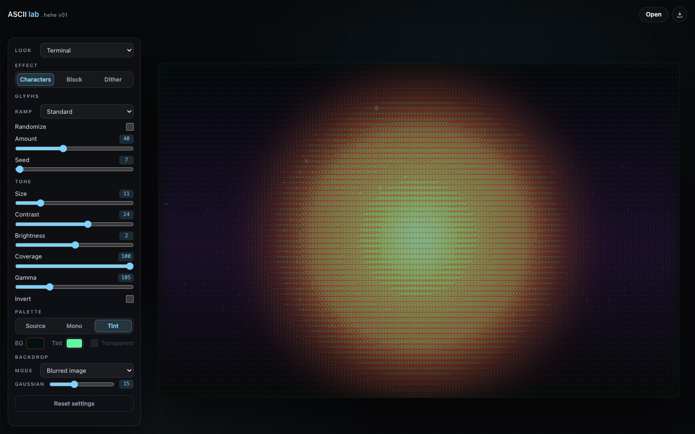

# ASCII lab . hehe v01

Turn any image into ASCII art — in one HTML file, entirely in your browser.

**Live demo:** https://hngviet275.github.io/ascii-lab-hehe/



## Why this exists

Most ASCII converters ship a build step, a CDN dependency or an upload. This one is a single `index.html` with inline CSS and JavaScript. Download it, double-click it, share it. Nothing is sent anywhere.

## Features

- **Four effects** — Characters, Braille (2×4 Unicode dot matrix), Block and Dither.
- **Six looks** — Terminal, Poster, Newsprint, Neon, Blueprint and Game Boy, each a one-click starting point.
- **Dither engine** — Ordered Bayer 8×8, Floyd–Steinberg error diffusion, and Atkinson (Mac '84), with retro color palettes (Game Boy DMG, CGA Mode 1, Cyberpunk Neon, Mono 1-bit).
- **Dot Grid Overlay** — Technical blueprint / CAD dot matrix grid overlay.
- **Glyph controls** — Five ramps, Invert Ramp toggle, and deterministic randomize with reproducible seed.
- **Tone controls** — Size, Char Opacity (10–100%), contrast, brightness, coverage, gamma, invert.
- **Palettes** — Source colours, monochrome, or a duotone tint.
- **Canvas colours** — Custom background and transparent output for PNG and SVG.
- **Backdrop modes** — Solid black, or a blurred and dimmed copy of the source image behind the glyphs, with an adjustable Gaussian blur.
- **Bundled font** — Characters use IBM Plex Mono, embedded in the HTML so glyphs and SVG exports match offline.
- **Exports** — PNG (1× / 2×), JPG, SVG, plus plain-text ASCII (.txt, including full Unicode Braille) and copy-to-clipboard.
- **Comfortable viewing** — drag & drop, wheel zoom, pinch zoom, pan, double-click to reset.
- **Responsive** — a floating side panel on desktop, a bottom sheet on mobile.
- **No external requests** — styles, scripts, fonts and the demo image are bundled in the single file.

## Use it

Open the live demo, or run the file locally:

```bash
git clone https://github.com/Hngviet275/ascii-lab-hehe.git
cd ascii-lab-hehe
python3 -m http.server 8766
# then open http://localhost:8766/
```

You can also open `index.html` directly from disk. If a browser refuses to read pixels back from local images, serve the folder over HTTP instead.

## Export sizes

PNG 1× matches the on-screen canvas, 2× doubles it. Exports are clamped to 8192 px per side and 16 megapixels. SVG keeps glyphs and blocks as real vector elements and only embeds a blurred JPEG layer when the backdrop mode is Blurred image. With a transparent background, PNG and SVG keep the alpha channel; JPG falls back to the chosen background colour.

## Keyboard

| Key | Action |
| --- | --- |
| `O` | Open an image |
| `+` / `-` | Zoom in / out |
| `0` or `F` | Fit / reset view |
| `Esc` | Close menus |

## Limits

- Static images only (no video).
- Canvas resolution is capped at 2× device pixel ratio for smooth interaction.
- Randomize applies to the Characters effect only.

## License

MIT — see [LICENSE](LICENSE). The bundled IBM Plex Mono font is licensed under the SIL Open Font License 1.1 — see [docs/IBM-Plex-Mono-OFL.txt](docs/IBM-Plex-Mono-OFL.txt).
